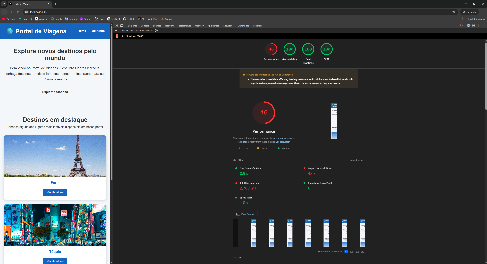
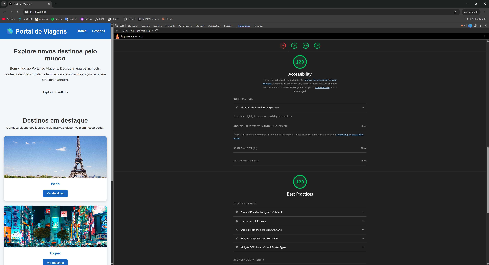
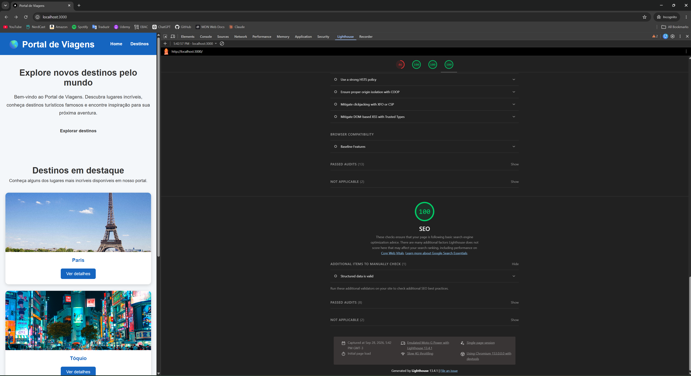
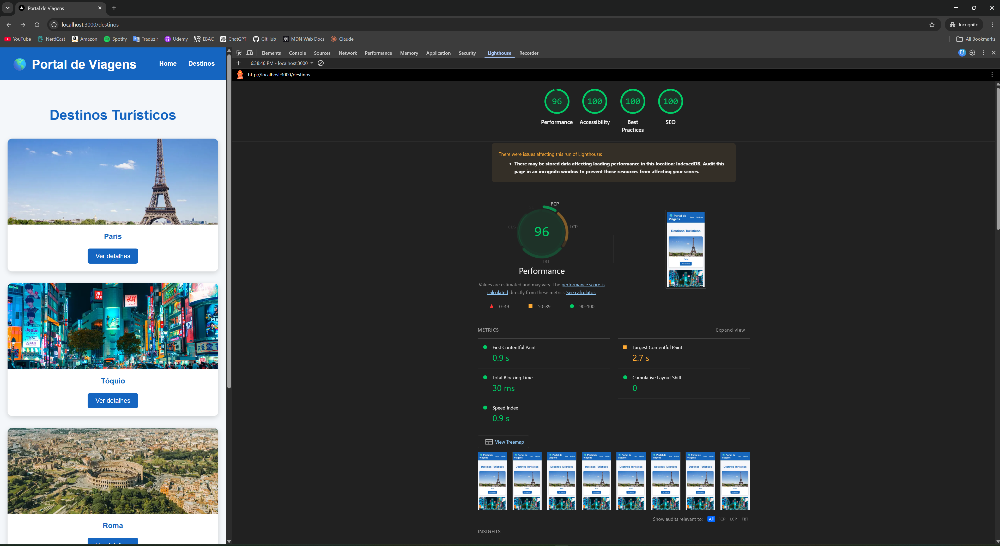
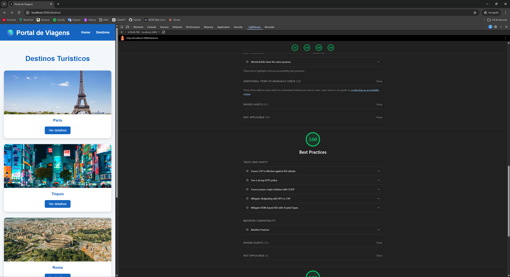
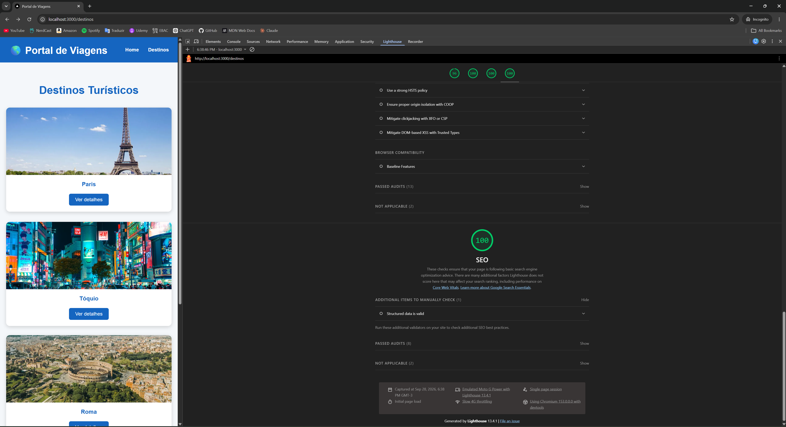

# Portal de Viagens — Otimização de Performance Web

## Sobre o projeto

O **Portal de Viagens** é uma aplicação desenvolvida com **Next.js, React e TypeScript** que apresenta destinos turísticos e permite acessar páginas individuais com informações sobre cada local.

O projeto já havia sido desenvolvido anteriormente durante o curso e foi reutilizado neste exercício com o objetivo de realizar uma análise real de performance, identificar gargalos e aplicar técnicas de otimização utilizadas no desenvolvimento web.

Antes do início dos testes de performance, a página inicial também foi aprimorada visualmente com uma seção de destaque e um grid de destinos, reutilizando os componentes e dados já existentes no projeto.

---

## Objetivo da otimização

O objetivo deste exercício foi analisar a performance da aplicação utilizando o **Chrome DevTools Lighthouse**, identificar os principais gargalos e aplicar melhorias capazes de produzir resultados mensuráveis.

O processo foi dividido em duas medições:

**ANTES:** aplicação original, ainda sem as técnicas de otimização.

**DEPOIS:** aplicação após otimização de imagens, carregamento de recursos, código, dependências e build de produção.

Os testes foram realizados utilizando as mesmas condições para que os resultados fossem comparáveis.

---

## Tecnologias utilizadas

- Next.js 16
- React 19
- TypeScript
- CSS Modules
- Chrome DevTools
- Lighthouse
- Sharp / Sharp CLI
- ESLint
- npm

---

## Metodologia dos testes

Os dois relatórios foram realizados no **Chrome DevTools Lighthouse**, utilizando a página inicial da aplicação.

As seguintes configurações foram mantidas nos testes inicial e final:

| Configuração | Valor |
|---|---|
| Página testada | Home `/` |
| Lighthouse Mode | Navigation |
| Device | Mobile |
| Performance | Ativado |
| Accessibility | Ativado |
| Best Practices | Ativado |
| SEO | Ativado |
| Ambiente | Build de produção |
| Servidor | `npm start` |

Antes das medições, a aplicação foi preparada utilizando:

```bash
npm run build
npm start
```

O uso do build de produção evita que recursos específicos do ambiente de desenvolvimento interfiram de forma significativa nos resultados.

---

# Relatório inicial — Antes das otimizações

## Pontuação inicial



O primeiro relatório apresentou os seguintes resultados:

| Categoria | Antes |
|---|---:|
| Performance | **46** |
| Accessibility | **100** |
| Best Practices | **100** |
| SEO | **100** |

Apesar das excelentes pontuações de acessibilidade, boas práticas e SEO, a aplicação apresentou somente **46 pontos em Performance**.

---

## Métricas iniciais





| Métrica | Resultado inicial |
|---|---:|
| First Contentful Paint — FCP | **0,9 s** |
| Largest Contentful Paint — LCP | **42,7 s** |
| Total Blocking Time — TBT | **2.700 ms** |
| Cumulative Layout Shift — CLS | **0** |
| Speed Index | **1,0 s** |

O problema mais grave encontrado foi o **Largest Contentful Paint de 42,7 segundos**.

O **Total Blocking Time de 2.700 ms** também indicava um tempo elevado de bloqueio da thread principal.

---

## Gargalos identificados


O Lighthouse identificou os seguintes problemas:

| Diagnóstico | Resultado |
|---|---:|
| Improve image delivery | **16.255 KiB de economia estimada** |
| Render-blocking requests | **240 ms de economia estimada** |
| Legacy JavaScript | **13 KiB de economia estimada** |
| Minimize main-thread work | **3,9 s** |
| Reduce unused JavaScript | **29 KiB de economia estimada** |
| Enormous network payload | **19.081 KiB** |
| Long main-thread tasks | **7 tarefas** |

Também foram apresentados diagnósticos relacionados a:

- LCP request discovery;
- Network dependency tree;
- LCP breakdown.

A análise mostrou que o principal gargalo estava relacionado às **imagens utilizadas pela aplicação**.

---

# Análise das imagens originais

As imagens utilizadas no projeto estavam armazenadas originalmente em formato JPEG.

Os tamanhos encontrados foram:

| Imagem | Tamanho original |
|---|---:|
| `maldivas.jpg` | 2,5 MB |
| `paris.jpg` | 4,0 MB |
| `roma.jpg` | 4,7 MB |
| `toquio.jpg` | 7,4 MB |
| **Total aproximado** | **18,6 MB** |

Esse total praticamente correspondia ao payload de aproximadamente **19 MB** identificado pelo Lighthouse.

Além disso, as resoluções originais eram muito superiores às dimensões necessárias para a aplicação:

| Imagem | Resolução original |
|---|---:|
| Maldivas | 5469 × 3646 |
| Paris | 5376 × 3584 |
| Roma | 5306 × 3535 |
| Tóquio | 7931 × 5290 |

Uma imagem com quase 8.000 pixels de largura estava sendo utilizada em elementos muito menores, como cards.

Isso gerava transferência desnecessária de dados e contribuía significativamente para o alto LCP.

---

# Melhorias aplicadas

## 1. Redimensionamento das imagens

As imagens originais foram redimensionadas para aproximadamente:

```text
1200 × 800 px
```

Essa resolução é muito mais adequada às dimensões em que as imagens são apresentadas na aplicação.

O redimensionamento reduziu a quantidade de dados necessária para carregar cada destino sem comprometer significativamente a qualidade visual.

---

## 2. Conversão de JPEG para WebP

Todas as imagens foram convertidas de:

```text
.jpg
```

para:

```text
.webp
```

Foi utilizado o **Sharp CLI** para realizar o processamento das imagens.

Exemplo do processo utilizado:

```bash
npx sharp -i "public/images/*.jpg" -o "public/images/{name}.webp" -f webp -q 80 resize 1200
```

Após o processamento, os novos tamanhos foram:

| Imagem | Antes | Depois |
|---|---:|---:|
| Paris | 4,0 MB | 120 KB |
| Maldivas | 2,5 MB | 128 KB |
| Tóquio | 7,4 MB | 216 KB |
| Roma | 4,7 MB | 276 KB |
| **Total** | **~18,6 MB** | **~740 KB** |

A redução total ficou próxima de **96%**.

---

## 3. Remoção das imagens JPEG antigas

Após confirmar que a aplicação estava utilizando corretamente as versões WebP, os arquivos JPEG originais foram removidos da pasta `public/images`.

Dessa forma, o repositório não mantém versões antigas e sem utilização dos mesmos recursos.

A pasta passou a conter somente:

```text
maldivas.webp
paris.webp
roma.webp
toquio.webp
```

---

## 4. Lazy loading

Foi implementado carregamento preguiçoso para imagens que não precisam necessariamente ser carregadas imediatamente.

Os cards utilizam lazy loading por padrão.

Isso evita que todas as imagens sejam carregadas ao mesmo tempo, reduzindo a quantidade de recursos necessários durante o carregamento inicial da página.

Entretanto, o lazy loading não foi aplicado indiscriminadamente.

O primeiro card da página inicial utiliza carregamento imediato:

```tsx
loading={index === 0 ? "eager" : "lazy"}
```

Isso foi feito porque uma imagem visível imediatamente pode participar do cálculo do **Largest Contentful Paint**, e atrasar seu carregamento poderia prejudicar o LCP.

---

## 5. Uso do componente `Image` do Next.js

O projeto utilizava anteriormente elementos HTML tradicionais:

```html

```

Durante a análise com ESLint, foram detectados warnings indicando que o uso desses elementos poderia resultar em maior consumo de banda e pior LCP.

Os elementos foram substituídos pelo componente:

```tsx
import Image from "next/image";
```

A alteração foi aplicada tanto aos cards de destinos quanto às páginas individuais.

O componente `Image` permite ao Next.js realizar tratamento e otimização mais adequada das imagens utilizadas pela aplicação.

---

## 6. Definição de dimensões das imagens

As imagens passaram a possuir dimensões explicitamente definidas:

```tsx
width={1200}
height={800}
```

Isso permite que o navegador conheça antecipadamente o espaço ocupado pelas imagens.

Essa técnica também contribui para evitar deslocamentos inesperados de layout.

O projeto manteve:

```text
CLS = 0
```

nos dois testes.

---

## 7. Imagens responsivas com `sizes`

Além das dimensões, foi utilizada a propriedade `sizes`.

Nos cards:

```tsx
sizes="(max-width: 600px) 100vw, (max-width: 900px) 50vw, 33vw"
```

Com isso, o navegador recebe informações sobre o tamanho aproximado que cada imagem ocupará dependendo da largura da tela.

No celular, a imagem pode ocupar praticamente toda a largura disponível.

Em telas intermediárias, aproximadamente metade.

Em desktops, aproximadamente um terço da largura.

Isso ajuda a evitar o download de imagens maiores do que realmente necessário.

---

## 8. Tratamento diferente para imagens prioritárias

As imagens que aparecem imediatamente para o usuário foram configuradas de maneira diferente das imagens secundárias.

Na página inicial, o primeiro destino possui carregamento `eager`.

Na página individual de cada destino, a imagem principal também possui:

```tsx
loading="eager"
```

Isso evita atrasar artificialmente recursos importantes para a renderização inicial e para o LCP.

---

## 9. Minificação e otimização de HTML, CSS e JavaScript

A aplicação utiliza Next.js e, portanto, o processo de build de produção realiza automaticamente as otimizações necessárias nos recursos gerados para produção.

Foi utilizado:

```bash
npm run build
```

O processo retornou:

```text
Creating an optimized production build ...
Compiled successfully
```

O build de produção é responsável por gerar os recursos utilizados pela aplicação em formato otimizado, incluindo JavaScript e CSS minificados e a saída HTML otimizada para produção.

Por esse motivo, não foi instalado um minificador externo adicional, evitando processamento redundante ou possíveis conflitos com o próprio processo de build do framework.

---

## 10. Testes sempre realizados utilizando build de produção

Os testes finais não foram realizados através do servidor de desenvolvimento:

```bash
npm run dev
```

Foi utilizada a versão preparada para produção:

```bash
npm run build
npm start
```

Essa escolha garante que as otimizações e minificações oferecidas pelo Next.js façam parte da medição.

---

## 11. Auditoria de código com ESLint

Foi realizada uma revisão do código utilizando:

```bash
npx eslint .
```

Inicialmente, o ESLint identificou dois warnings relacionados ao uso de ``.

Esses elementos foram substituídos por `Image` do Next.js.

Após as alterações, o comando foi executado novamente e terminou com:

```text
0 errors
0 warnings
```

Não foram identificados outros imports, variáveis ou problemas relevantes pelo ESLint.

---

## 12. Revisão de código não utilizado

Além da análise automática através do ESLint, foi realizada uma revisão da estrutura utilizada pela aplicação.

Os arquivos JPEG antigos foram removidos após a migração para WebP, eliminando recursos que já não eram necessários.

O projeto também passou por novo build de produção após as alterações para garantir que nenhuma modificação tivesse quebrado a aplicação.

---

## 13. Análise das dependências

As dependências instaladas foram analisadas utilizando:

```bash
npm ls --depth=0
```

O projeto não utiliza bibliotecas de interface ou utilitários pesados no código executado pelo navegador que justificassem uma substituição por alternativas menores.

Por isso, a etapa de substituição de bibliotecas pesadas foi considerada **não aplicável neste projeto**.

Essa decisão evita realizar alterações artificiais apenas para cumprir o exercício sem benefício real para a aplicação.

---

## 14. Revisão de pacotes com `npm prune`

Também foi executado:

```bash
npm prune
```

como parte da revisão da árvore de dependências instalada.

A auditoria ajudou a verificar o estado das dependências antes da conclusão das otimizações.

---

## 15. Atualização do Next.js

Durante a auditoria das dependências, foi identificada uma vulnerabilidade crítica relacionada à versão anteriormente utilizada do Next.js.

O framework foi atualizado de:

```text
Next.js 16.3.0
```

para:

```text
Next.js 16.3.6
```

O `eslint-config-next` também foi atualizado para a mesma versão, mantendo compatibilidade entre as ferramentas.

Embora essa alteração esteja principalmente relacionada à segurança e manutenção da aplicação, ela fez parte da revisão técnica realizada durante o processo de otimização.

---

## 16. Auditoria de segurança das dependências

Foi utilizado:

```bash
npm audit
```

Inicialmente foram encontradas:

```text
3 vulnerabilidades
2 high
1 critical
```

Após a atualização do Next.js e correções compatíveis das dependências, uma nova auditoria foi realizada.

Resultado final:

```text
0 vulnerabilities
```

Não foi necessário utilizar:

```bash
npm audit fix --force
```

evitando atualizações forçadas que poderiam causar incompatibilidades no projeto.

---

## 17. Validação final do build

Após todas as alterações, o projeto foi novamente compilado:

```bash
npm run build
```

O Next.js finalizou o processo sem erros.

Também foram testadas manualmente:

```text
Home
/destinos
/destinos/[id]
```

As páginas e imagens permaneceram funcionando corretamente após as otimizações.

---

# Relatório final — Depois das otimizações

## Pontuação final



Após as otimizações, a pontuação passou para:

| Categoria | Antes | Depois |
|---|---:|---:|
| Performance | **46** | **96** |
| Accessibility | 100 | 100 |
| Best Practices | 100 | 100 |
| SEO | 100 | 100 |

A pontuação de Performance aumentou **50 pontos**.

As outras categorias permaneceram com pontuação máxima.

---

## Métricas finais





O relatório final apresentou:

| Métrica | Antes | Depois |
|---|---:|---:|
| Performance | **46** | **96** |
| Accessibility | **100** | **100** |
| Best Practices | **100** | **100** |
| SEO | **100** | **100** |
| First Contentful Paint — FCP | **0,9 s** | **0,9 s** |
| Largest Contentful Paint — LCP | **42,7 s** | **2,7 s** |
| Total Blocking Time — TBT | **2.700 ms** | **30 ms** |
| Cumulative Layout Shift — CLS | **0** | **0** |
| Speed Index | **1,0 s** | **0,9 s** |
| Economia potencial em imagens | **16.255 KiB** | **127 KiB** |
| Long main-thread tasks | **7** | **3** |

---

# Comparativo antes × depois

O resultado demonstra uma melhoria significativa de performance.

### Performance

```text
46 → 96
```

O projeto apresentou um ganho de **50 pontos** no Lighthouse.

### Largest Contentful Paint

```text
42,7 s → 2,7 s
```

O LCP foi uma das métricas que apresentou maior evolução.

A redução está diretamente relacionada à diminuição do tamanho das imagens, à adoção do formato WebP, ao redimensionamento, ao uso de `next/image` e à estratégia de carregamento.

### Total Blocking Time

```text
2.700 ms → 30 ms
```

O TBT também apresentou uma redução muito significativa.

### Speed Index

```text
1,0 s → 0,9 s
```

A métrica já possuía um bom resultado inicialmente e apresentou uma pequena melhora adicional.

### Cumulative Layout Shift

```text
0 → 0
```

A aplicação não apresentou deslocamentos relevantes de layout em nenhum dos dois testes.

### First Contentful Paint

```text
0,9 s → 0,9 s
```

O FCP já possuía um resultado rápido antes das alterações e foi mantido após as otimizações.

---

# Comparação dos diagnósticos


Um dos resultados que melhor demonstra o impacto das alterações está no diagnóstico de entrega das imagens.

Antes:

```text
Improve image delivery
Est savings of 16,255 KiB
```

Depois:

```text
Improve image delivery
Est savings of 127 KiB
```

A diferença demonstra que o principal gargalo da aplicação foi efetivamente reduzido.

As tarefas longas da thread principal também passaram de:

```text
7 tarefas
```

para:

```text
3 tarefas
```

Alguns diagnósticos permaneceram presentes no relatório final:

| Diagnóstico | Antes | Depois |
|---|---:|---:|
| Legacy JavaScript | 13 KiB | 13 KiB |
| Render-blocking requests | 240 ms | 240 ms |
| Unused JavaScript | 29 KiB | 29 KiB |
| Long main-thread tasks | 7 | 3 |
| Improve image delivery | 16.255 KiB | 127 KiB |

Esses resultados são importantes porque demonstram que a melhora observada não foi atribuída artificialmente a todos os diagnósticos.

Os dados indicam que a **otimização da entrega das imagens foi o principal fator responsável pelo ganho de performance**.

---

# Otimizações de maior impacto

A otimização que apresentou maior impacto foi o tratamento das imagens.

Originalmente, somente quatro arquivos JPEG totalizavam aproximadamente:

```text
18,6 MB
```

Após redimensionamento e conversão para WebP, passaram a totalizar aproximadamente:

```text
740 KB
```

Isso representa uma redução próxima de:

```text
96%
```

Além disso, o uso de lazy loading, carregamento prioritário das imagens visíveis, dimensões explícitas, `sizes` responsivo e `next/image` melhorou a estratégia de entrega desses recursos.

A redução do aviso `Improve image delivery` de **16.255 KiB para apenas 127 KiB** reforça a relação entre essas mudanças e o resultado final.

---

# Resultado geral

O processo de otimização aumentou a pontuação de Performance de:

```text
46
```

para:

```text
96
```

O Largest Contentful Paint caiu de:

```text
42,7 segundos
```

para:

```text
2,7 segundos
```

e o Total Blocking Time caiu de:

```text
2.700 ms
```

para:

```text
30 ms
```

As pontuações de Accessibility, Best Practices e SEO permaneceram em **100 pontos**.

---

# Conclusão

Este exercício demonstrou a importância de realizar otimizações baseadas em métricas reais em vez de realizar alterações apenas com base em percepções subjetivas.

O Lighthouse permitiu identificar que o principal gargalo do Portal de Viagens estava relacionado à entrega das imagens.

A aplicação utilizava somente quatro imagens, mas esses arquivos totalizavam aproximadamente 18,6 MB devido às resoluções muito superiores às necessárias.

Após o redimensionamento, conversão para WebP e melhoria da estratégia de carregamento, o projeto apresentou uma evolução clara e mensurável.

Além das imagens, foram revisados o código, as dependências, os recursos não utilizados, a utilização de `next/image`, o comportamento responsivo das imagens, o build de produção, a minificação e a segurança das dependências.

O resultado final demonstra que pequenas decisões relacionadas ao formato e à forma de entrega dos recursos podem produzir um impacto muito significativo na experiência do usuário e na performance geral de uma aplicação web.

---

# Como executar o projeto

Instale as dependências:

```bash
npm install
```

Crie o build de produção:

```bash
npm run build
```

Inicie a aplicação:

```bash
npm start
```

Depois acesse:

```text
http://localhost:3000
```

---

# Estrutura dos relatórios

Os relatórios e prints utilizados na comparação estão organizados da seguinte maneira:

```text
docs/
└── performance/
    ├── before/
    │   ├── lighthouse-summary.png
    │   ├── lighthouse-diagnostics.png
    │   ├── lighthouse-metrics1.png
    │   └── lighthouse-metrics2.png
    │
    └── after/
        ├── lighthouse-summary.png
        ├── lighthouse-diagnostics.png
        ├── lighthouse-metrics1.png
        └── lighthouse-metrics2.png
```

---

# Repositório

O código-fonte completo e os relatórios de performance estão disponíveis neste repositório público no GitHub.

**Link do repositório: https://github.com/AndreRocksz/SiteViagens.git